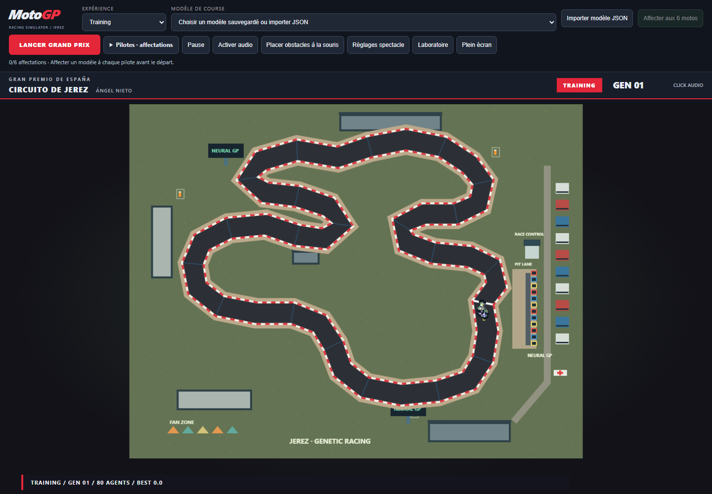

# MotoGP Simulation

Simulation p5.js combinant trois approches : **algorithme génétique**, **évitement réactif d'obstacles** et **séparation/anticollision entre motos**. Une population apprend à parcourir le Circuito de Jerez - Ángel Nieto. Le pilote ne reçoit ni trajectoire, ni centre de piste, ni position du prochain checkpoint. Ses entrées sont sept distances aux limites, sa vitesse et sa commande précédente.

## Démonstration

- [Jouer en ligne](https://itsghali.github.io/motogp-simulation/)
- [Voir la vidéo de démonstration](https://youtu.be/WALYf7b9y7I)
- [Code source](https://github.com/itsghali/motogp-simulation)



Documentation académique : [spécifications complètes](SPECIFICATIONS.md) et [problèmes rencontrés avec leurs solutions](PROBLEMES-ET-SOLUTIONS.md).

## Algorithmes utilisés

| Algorithme | Fonctionnement |
|---|---|
| Algorithme génétique + réseau neuronal 9-12-2 | Chaque moto transforme neuf entrées en direction et accélération. Les meilleurs génomes sont sélectionnés, croisés et mutés selon leur progression, leurs checkpoints, leurs tours et leurs pénalités. |
| Évitement d'obstacles | Des sondes projettent la position future de la moto. En cas de danger, le contrôleur choisit un côté libre, conserve ce choix pendant le contournement et freine si la distance disponible devient insuffisante. |
| Séparation / anticollision | La moto repère les voisines proches, mesure distance et vitesse relative, puis applique une répulsion latérale ou un freinage longitudinal pour conserver une distance de suivi et anticiper un contact. |

L'évitement et la séparation sont des aides réactives activables en Grand Prix. Ils restent séparés du génome et de l'entraînement génétique : `reference-steering.js` calcule leurs forces, puis `race-steering.js` et `motorcycle-avoidance.js` les composent avec la commande neuronale. Le danger est prioritaire, la force finale reste limitée à `maxForce` et la locomotion reste déléguée à `Vehicle`.

L'inférence neuronale de toute la population est batchée avec TensorFlow.js. Le navigateur demande WebGL haute performance et identifie la RTX 3070 comme configuration optimale. Un autre GPU WebGL reste accepté pour la démonstration publique ; sans WebGL, TensorFlow.js passe au CPU. p5.js, les capteurs géométriques, le GA, l'interface et l'orchestration restent exécutés sur le CPU.

## Circuit et sources

- Circuit : Circuito de Jerez - Ángel Nieto, Espagne.
- Longueur : 4,423 km.
- Largeur : environ 11 m.
- Virages MotoGP : 13, dont 8 à droite et 5 à gauche.
- Sens : horaire.
- Départ/arrivée : ligne droite des stands.

Sources publiques consultées le 15 octobre 2026 :

- [MotoGP - Grand Prix d'Espagne 2026](https://www.motogp.com/en/calendar/2026/event/espana/a24be69b-8472-4aa4-9e83-d3610e0f1d98)
- [Circuito de Jerez - histoire et longueur officielle](https://circuitodejerez.com/en/circuito/)
- [RFME - plan sportif, ligne et sens](https://rfme.com/wp-content/uploads/2022/09/7_CircuitoJerezAngelNieto_InformacionDeportiva.pdf)

Le contour est une simplification normalisée à 42 points du plan public, sans prétention SIG ou topographique. La piste simulée est volontairement élargie à **44 pixels** par défaut (auparavant 24), réglable de 24 à 52 pixels. Cette largeur pédagogique ne représente pas les 11 mètres réels à l'échelle. Le rendu, les murs des capteurs et le contrôle des limites utilisent les mêmes polygones.

## Architecture

- `circuit.js` : centre de piste, limites, ligne, checkpoints ordonnés, projection et contrôle anti-raccourci.
- `motorcycle.js` : pilote simulé ; sous-classe de `Vehicle`.
- `venue.js`, `replay-motorcycle.js` : décor et reconstruction visuelle, héritant de `Vehicle`.
- `genome.js` : réseau dense léger et sept traits de conduite.
- `steering.js` : décision et force Reynolds limitée.
- `reference-steering.js` : calcul des forces d'évitement et de séparation.
- `race-steering.js`, `motorcycle-avoidance.js` : composition des aides réactives du Grand Prix.
- `gpu-inference.js` : tenseurs persistants et inférence batchée GPU WebGL.
- `genetic-algorithm.js` : tournoi, élitisme, croisement, mutation.
- `fitness.js` : récompenses, pénalités et agrégation multi-scénarios.
- `scenario.js` : variations reproductibles par graine.
- `validation.js` : trois tours consécutifs sur trois scénarios réservés.
- `simulation.js` : cycle entraînement, génération, validation.
- `model-storage.js` : sauvegarde versionnée dans `localStorage`.
- `ui.js` : contrôles, état et statistiques.
- `sketch.js` : boucle p5 et rendu uniquement.

Le flux de mouvement reste : perception, décision du génome, vitesse désirée, `steering = desiredVelocity - currentVelocity`, limite `maxForce`, `applyForce`, puis `Vehicle.update()`.

## Expérience Grand Prix

Choisir explicitement **Modèle de course** dans la barre supérieure, ou **Importer modèle JSON**, puis **Lancer Grand Prix** : homologation → introduction → découverte du tracé → grille → cinq feux rouges → course → résultats → podium. Sans choix, la course est refusée : aucun champion ni agent courant ne remplace le modèle demandé. Sauvegarder ou importer sélectionne cette entrée pour la prochaine course. Le nom et le profil affichés viennent de la même entrée que le génome. La physique Grand Prix commune est définie dans `grand-prix-rules.js` : vitesse 5,5, force 0,18 ; aucun JSON ni réglage du laboratoire ne la remplace. La largeur de course reste réglable. Chaque affectation doit réussir trois tours et 63 checkpoints sans sortie sous cette physique avant le départ. Un échec indique le pilote et sa raison ; réentraîner le cerveau avec le règlement commun. Importer pendant une course prépare la prochaine sans changer la course actuelle. **Expérience → Training** restaure exactement la population interrompue et son lot d’inférence. Le GA ne tourne pas pendant une course ; l’homologation reste distincte de la validation d’entraînement et ne modifie aucun modèle original.

**Moteurs et commentaire** : Activer audio fonctionne aussi pendant l’entraînement. Le lancement du Grand Prix active l’audio automatiquement après clic. Les moteurs suivent vitesse, gaz et proximité. Le commentaire événementiel utilise la synthèse vocale. Un MP3/WAV/OGG peut être importé localement comme ambiance ; aucun fichier utilisateur sans licence prouvée n’est publié dans le repo.

**Pilotes et interface** : Márquez 93, Bagnaia 63, Martín 89, Quartararo 20, Acosta 37 et Binder 33 composent une grille Invitational. Chaque pilote possède une affectation indépendante de modèle sauvegardé/importé ; même cerveau autorisé sur plusieurs lignes. Poids, traits et profil du modèle de chaque ligne sont conservés. L’option **Modifier le profil pour créer des variantes MotoGP**, désactivée par défaut, personnalise les traits de ces copies sans changer leurs poids ni le modèle enregistré. Si activée, intensité initiale 100 %, réglable dans Réglages spectacle ; profils pédagogiques inspirés, pas des répliques exactes de pilotes réels. Présentation rouge/noir, classement et fiche pilote ; bouton **Laboratoire** pour retrouver les contrôles, charger et sauvegarder les modèles.

Modes Training, Race, Cinematic, Debug et Spectator ; sept caméras, sélection par clic, mini-carte, classement, drapeaux, commentaires français événementiels et sous-titres. Audio procédural original activé uniquement après clic, mix de huit catégories, quatre moteurs maximum. Les tribunes sont mises en cache sur deux surfaces graphiques, sans objets DOM par spectateur.

Replay des dix dernières secondes à 0,5× ou 0,25× ; trajectoire et carte des sorties/fréquentation dans **Réglages spectacle**. Après une validation réellement réussie, une carte spéciale permet de revoir les trois tours complets et d’exporter leur trajectoire JSON. Les enregistrements en mémoire disparaissent au rechargement ; le fichier trajectoire reste un export d’analyse, distinct d’un modèle à importer.

Raccourcis, budgets, architecture et limites : [GRAND_PRIX.md](GRAND_PRIX.md). Tests : `npm test`, puis `npm run validate:seed`. Aucun changement de `vehicle.js`.

## Génome et profils

Caractéristiques détaillées, valeurs initiales et règles de nommage sauvegarde/export : [PROFILS.md](PROFILS.md). Changer le profil l’applique immédiatement au modèle : traits remplacés, poids neuronaux conservés, validation relancée. Le nom et le JSON suivent ce profil réellement appliqué.

Le génome contient les poids d'un contrôleur 9-12-2 et sept traits : anticipation, direction, freinage, accélération, agressivité, correction vers la piste et sensibilité aux virages.

Profils initiaux : prudent, équilibré, agressif, freinage tardif, trajectoire régulière. Ils changent seulement les distributions initiales. Les règles, capteurs, checkpoints et pénalités restent identiques.

## Fitness

Récompenses par défaut : checkpoint 160, distance sur piste 0,12 par pixel, progression locale 100, tour 2400, chrono jusqu'à 800.

Pénalités par défaut : sortie 120 par pas, collision avec une limite 700, mauvais sens 350, stagnation 220, raccourci 1000, checkpoint manqué 900. Les candidats sont des essais indépendants superposés pour comparaison : ils ne se heurtent pas entre eux.

Pour un scénario, `score = (1 + récompenses) / (1 + pénalités / 160)`. Le bonus chrono vaut `800 * 60000 / (60000 + temps_ms)` : deux temps différents donnent deux bonus différents. Le score global est la moyenne, multipliée par `0,1 + 0,9 * (1 - taux_d'échec)^2`. Même si tous les essais échouent, une progression plus importante garde une meilleure note ; échouer partout réduit la moyenne d'un facteur dix.

La distance récompensée est le maximum de progression longitudinale autorisée par les checkpoints, jamais la somme des déplacements. Revenir en arrière puis repasser au même endroit, tourner sur place ou rouler hors piste n'ajoute aucune distance récompensée. Le départ doit être franchi avant le premier checkpoint. Le test de chaque déplacement vérifie les limites sur tout le segment, pas seulement son arrivée.

## Entraînement et validation

Chaque génération évalue les génomes sur un ensemble commun de scénarios d'entraînement. Variations : pose initiale, vitesse, adhérence, bruit capteur, moteur et freinage. L'ordre est permuté de façon reproductible entre générations ; conserver le même ensemble rend les scores des champions comparables. Le bruit d'un scénario ne dépend pas de l'indice du candidat. La graine par défaut est `2027` ; une nouvelle population avec les mêmes réglages et la même graine reproduit volontairement le même départ.

La validation démarre automatiquement lorsqu'un candidat termine tous les scénarios d'entraînement, ou manuellement avec « Relancer validation ». Un budget épuisé sans réussite complète donne « entraînement en pause », sans validation prématurée. « Reprendre entraînement » conserve les génomes et ouvre un nouveau budget. Le budget par défaut est 200 générations ; la durée maximale d'un tour est 120 secondes simulées.

La validation utilise trois scénarios réservés et une seule moto pendant **trois tours continus, sans téléportation ni réinitialisation de vitesse**. Le premier scénario fournit aussi la pose initiale. Aux deux passages de ligne suivants, adhérence, bruit, moteur et freins changent pour le scénario réservé suivant ; ses variations de pose initiale ne sont pas appliquées en plein mouvement. Les statistiques sont calculées séparément pour chaque tour. Tout écart de limites, checkpoint manqué, raccourci, contresens, collision ou dépassement de durée invalide immédiatement la tentative, avec une raison affichée.

Les paramètres physiques, la largeur et les poids de fitness sont figés pour une génération et pendant la validation. Les changements des curseurs sont appliqués à la génération suivante (ou à une relance explicite) ; modifier les conditions remet le score de comparaison à zéro. La vitesse d'affichage peut changer immédiatement.

Le panneau distingue les réglages actifs des réglages en attente. Mutation, amplitude, croisement, élites et taille de population contrôlent les enfants de la prochaine génération, sans modifier le score des essais en cours. Les trois options d'affichage et la vitesse de simulation sont immédiates. Changer le profil applique immédiatement ses traits au meilleur modèle et relance sa validation ; sans champion, une population du profil choisi est créée. Pour reproduire intégralement une graine, utiliser **Nouvelle population**. « Relancer validation » lit immédiatement les réglages affichés. La reprise et une nouvelle population effacent les anciens échecs de validation ; une sauvegarde refusée par le navigateur affiche une erreur sans bloquer l'interface.

« Appliquer les réglages » relance immédiatement les essais avec les valeurs affichées, conserve les génomes et adapte la taille de population. Une génération d'entraînement relancée garde son numéro ; une validation repart au premier des trois tours. Une pause utilisateur reste une pause pour les réglages ordinaires ; changer le profil relance explicitement la simulation. Après budget épuisé ou validation échouée, « Démarrer / pause » reprend réellement l'entraînement ; après validation réussie, il relance la validation du champion.

Pendant l'entraînement, pilotes éliminés ou arrivés sont masqués et « Afficher seulement meilleur » suit en priorité un pilote vivant. Le panneau affiche son état, sa vitesse et le temps simulé pour distinguer une pause, une fin d'essai et un véhicule lent. Une progression insuffisante pendant 300 pas (5 s simulées) élimine le pilote : le seuil de progression vaut `max(2 px, maxspeed × 0,05 × 240)`, renouvelé à chaque progrès suffisant ou franchissement initial du départ. Cela détecte aussi les boucles et le roulage presque à l'arrêt sans ajouter d'accélération artificielle. À vitesse nulle, orientation et capteurs conservent le dernier cap, jamais celui de la ligne de départ. La validation échoue si le pilote stagne.

Le test `npm run validate:seed` exécute perception, réseau, sélection, forces, locomotion fournie et checkpoints, sans trajectoire ni événements de tour injectés. Il utilise une référence numérique CPU et une doublure arithmétique de p5.Vector, explicitement distinctes du rendu navigateur et de WebGL. Avec graine 2027, population 12, deux scénarios d'entraînement et largeur 44, il sélectionne en génération 1 un génome qui termine trois tours réservés en environ 21,58 s, 23,37 s et 22,98 s sans sortie. Cette preuve reproductible ne garantit pas la convergence d'autres graines, profils ou réglages.

Les nouvelles sauvegardes locales (format 2) incluent le génome, les réglages actifs, la graine et les statistiques de validation. Les anciennes sauvegardes restent rechargeables. Tout chargement relance une validation ; un ancien statut sauvegardé ne suffit jamais à déclarer un modèle validé.

Les boutons de stockage répondent immédiatement dans un encadré sous les commandes, indépendamment du rendu. Sans meilleur génome, terminer une première génération évaluée avant de sauvegarder. La bibliothèque `localStorage` reste propre au navigateur et à l'origine (protocole, hôte et port). Par exemple, `localhost`, `127.0.0.1`, les ports `5500` et `8765`, ou deux navigateurs, ne partagent pas nécessairement leurs sauvegardes. Export/import JSON permet de transférer les modèles entre ces environnements. Les absences de modèle et erreurs de stockage sont affichées explicitement.

### Plusieurs modèles et fichiers locaux

1. Saisir un nom, puis **Sauvegarder meilleur modèle** : ajoute une entrée distincte avec date, score et historique, sans remplacer les précédentes. Deux noms identiques restent deux modèles distincts.
2. Choisir une entrée dans **Modèle local à charger ou exporter** ; **Charger modèle** restaure ce génome et ses réglages puis démarre une nouvelle validation.
3. **Exporter JSON** télécharge uniquement l'entrée sélectionnée sous forme de fichier `.json`. Le navigateur détermine le dossier de téléchargement.
4. **Importer JSON** ouvre le choix de fichier local, ajoute le modèle sans écrasement et démarre sa validation si le GPU est prêt. Sans GPU, l'import reste possible dans la bibliothèque ; charger ensuite pour valider.

Règle stricte : **« modèle validé » uniquement après exactement trois tours complets consécutifs réussis sur les trois scénarios réservés**. Un statut ou historique contenu dans un JSON n'est jamais une preuve : l'import supprime sa revendication de validation, et tout chargement remet les compteurs de la tentative à zéro. Une sortie, un checkpoint manqué, un contresens, une collision, une stagnation ou un timeout invalide la tentative selon les règles existantes. Les modèles non validés peuvent être sauvegardés comme essais, sans être annoncés comme validés.

Charger/importer efface aussi score de comparaison, meilleur chrono et résultats de génération de l'ancien essai. Le score enregistré du fichier reste un historique dans la bibliothèque, pas un score réévalué. « Reprendre entraînement » repart du modèle chargé : premier individu identique, autres individus dérivés par les mutations actuellement demandées, sans mélanger l'ancienne population. Les mutations sont tirées uniquement à la reprise, avec graine reproductible ; mutation zéro conserve des copies identiques.

Pendant validation, changer un curseur physique ne change ni la moto ni les tours déjà acquis tant que les réglages restent en attente. « Appliquer les réglages » garde le génome mais efface tous les tours de la tentative et impose trois nouveaux tours. Mutation/croisement/fitness ne pilotent pas cette validation et servent seulement à l'entraînement. Le panneau distingue un profil initial non appliqué (nécessite « Nouvelle population ») et une validation acquise uniquement pour les réglages actifs, pas pour les changements en attente. Sauvegarder conserve les réglages réellement actifs ; l'entrée d'origine n'est jamais modifiée automatiquement.

La bibliothèque utilise une nouvelle clé locale et conserve l'ancienne sauvegarde comme « Ancienne sauvegarde ». Son ajout à la nouvelle bibliothèque ne modifie ni ne supprime l'ancien emplacement. Les fichiers exportés gardent le format de modèle version 2 ; les anciens fichiers versions 1 et 2 sont acceptés. Imports limités à 2 Mo, génome et nombres contrôlés ; un fichier invalide ou quota dépassé laisse les modèles existants intacts. Les données affichées utilisent du texte, pas du HTML issu des fichiers.

`model-storage.js` gère bibliothèque, compatibilité et validation du JSON ; `model-files.js` gère uniquement lecture de fichier et téléchargement Blob ; `ui.js` gère nom/liste/sélection ; `sketch.js` orchestre les actions et la revalidation. Aucun changement de locomotion.

## Paramètres initiaux

Population 80 ; mutation 0,08 ; amplitude 0,18 ; croisement 0,80 ; élites 5 ; scénarios 3 ; budget 200 générations ; durée maximale 120 s/tour ; graine 2027 ; largeur 44 px ; `maxSpeed` 5,5 ; `maxForce` 0,18 ; accélération 1 ; freinage 1,2 ; portée 90 ; bruit 1 ; adhérence 1 ; vitesse simulation 4.

## Technologies

- JavaScript sans framework et p5.js 1.9.4
- TensorFlow.js 4.22.0 avec WebGL et repli CPU
- Web Audio API et Speech Synthesis API
- Node.js Test Runner
- GitHub Pages

Licences et provenance des composants tiers : [THIRD-PARTY-NOTICES.md](THIRD-PARTY-NOTICES.md).

## Exécution

Installer la dépendance de test, servir ce dossier avec un serveur HTTP, puis ouvrir `index.html` :

```text
npm ci
python -m http.server 8765 --bind 127.0.0.1
```

Ouvrir `http://127.0.0.1:8765/index.html`. Le panneau `Calcul TensorFlow` indique le renderer choisi. Une RTX 3070 offre le mode optimal. Un autre GPU WebGL ou le repli CPU permet de consulter la démonstration, avec entraînement potentiellement plus lent. Une préférence « haute performance » reste une demande : Windows et le navigateur gardent le choix final de l’adaptateur.

Tests :

```text
npm test
npm run validate:seed
```

Les 278 tests couvrent aussi les capteurs près des murs, le signe des corrections, la conservation d'un signal de fitness après échec, l'indépendance des essais, les paramètres restaurés, le budget reprenable et une simulation complète jusqu'à trois tours continus. `vehicle.js` n'est pas modifié.

`tests/controls.test.cjs` vérifie les 29 curseurs (bornes, affichage, configuration, restauration), les 9 boutons et le sélecteur de fichiers via les véritables callbacks de `sketch.js`, les 5 profils, les 3 options de rendu, la vitesse, les 11 poids de fitness, les changements différés et les erreurs de stockage. Les retours sauvegarde/chargement sont testés sans `draw()`, GPU absent/en initialisation, ainsi qu'après réinitialisation complète de l'application avec stockage conservé. `tests/model-library.test.cjs` couvre conservation des modèles, migration, sélection, JSON, quota et adaptateur de fichiers. Ces tests utilisent un DOM et une inférence numériques de test ; les contrôles navigateur sont décrits séparément dans VALIDATION.md.

Résultats vérifiés, paramètres et limites : [VALIDATION.md](VALIDATION.md).


## Grand Prix neuronal — évolution par sprints

Grille d’affectation indépendante des six cerveaux, import JSON multiple, rendu moto partagé avec replay, séparation et évitement optionnels, obstacles éditables, drones boids, moteurs continus et commentaire français par événements. Voir [GRAND_PRIX.md](GRAND_PRIX.md) pour les réglages et [SPRINTS.md](SPRINTS.md) pour les preuves/limites. Affectations et assistances prennent effet à la prochaine course. Training/fitness/protocole de validation inchangés ; `vehicle.js` protégé.


Retour utilisateur : obstacles par bouton **Placer obstacles à la souris**, clic sur piste / Maj + clic pour supprimer. Anglais par défaut, bouton **Tester la voix**, voix prioritaire sur moteurs/ambiance. Véritable enregistrement moteur fourni (ezwa, domaine public), synthèse combustion en secours ; import optionnel d’une autre boucle moteur dans Réglages spectacle. Voir GRAND_PRIX.md pour prise d’effet et limites.
